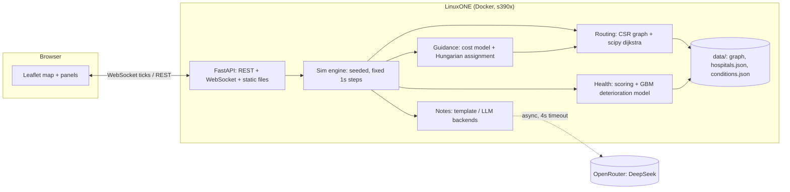

# TRIAGE — Project Context (read this first)

IBM Z Datathon 2026 · Theme: **Real-time AI for Critical Decisions** (healthcare prioritisation) · Hub: Manchester · Window: 17 Oct to 18 Oct 2026 · Platform: IBM LinuxONE Community Cloud (**s390x, big-endian**).

This file is the single source of truth for humans and AI coding assistants. If code and this file disagree, fix one of them in the same commit.

---

## 0. Rules for anyone (human or AI) writing code here


1. **Dependencies must run on s390x.** Before adding any package, check it installs on the LinuxONE box. Prefer pure-python wheels or Ubuntu apt packages. Ask the team before adding anything with compiled code.
2. **Do not edit another module's contract** (section 7) without telling its owner. Contracts are how six people avoid merge conflicts.
3. **The sim loop never makes network calls.** LLM calls are async, cached, timed out, and always have a template fallback.
4. **Determinism.** All randomness comes from one seeded RNG per scenario. Same seed plus same policy gives the same run.
5. Small commits, own branch (`name/feature`), PR into `main`, one reviewer. Python 3.12, type hints, `ruff` format, tests for anything in `guidance/` and `health/`.

---

## 1. What we are building

A web app that **guides many ambulances to the right hospital at the same time**. It predicts how fast each patient is deteriorating from their vitals, then jointly assigns every ambulance to a hospital so the total expected deterioration at the moment treatment starts is as small as possible. It accounts for traffic, roadblocks, hospital beds, queue length, specialist units and other ambulances already heading to the same hospital. A built-in simulation proves it works by running the same scenario under (a) naive "go to nearest hospital" and (b) TRIAGE guidance, then showing the difference.

**Name:** TRIAGE. Working acronym: *Time-critical Routing and Intelligent Ambulance Guidance Engine*.

**Three AI roles (use this wording in the pitch):**
| Role | What | Technique | Where it runs |
|---|---|---|---|
| Predict | Patient severity now and deterioration rate | Gradient boosted regressor trained on synthetic patients | **LinuxONE, in container** |
| Decide | Which ambulance goes to which hospital, with live diversion | Cost model plus optimal assignment (Hungarian algorithm) | **LinuxONE, in container** |
| Communicate | Handover note sent ahead to the hospital | LLM (DeepSeek via OpenRouter), template fallback | External API, optional |

### Changes from the original overview (decision log)

| Original idea | Decision | Why |
|---|---|---|
| LLM generates the live deterioration rate | **Deterministic model computes it. LLM only writes the words.** | LLM numbers are unreproducible, unauditable, slow and can hallucinate. Judges and hospitals both need numbers that can be explained. |
| "OpenStreetMap source code as training data" | **OSM road data (not source code) becomes a routing graph. Nothing is trained on it.** | Shortest path on a weighted graph is an algorithm, not a learning problem. What we train is the deterioration model. |
| PyTorch for training | **Drop it. Use scikit-learn (and IBM Snap ML if present in the lab image).** | Tabular data, a few thousand rows. PyTorch on s390x is a risk with no benefit. |
| Google Maps API for traffic | **Simulated traffic model** (time-of-day curve, road-class factors, user-placed roadblocks) | Free, no billing card, reproducible, and controllable live in the demo. A real traffic API cannot be made to jam on cue. |
| Compare against "real outcomes with deaths" | **Compare against a baseline policy inside the same simulation. Report time-to-treatment and deterioration at handover. Never claim lives saved.** | We have no real outcome data. A fabricated mortality figure would be the first thing a judge challenges. |
| Kaggle datasets "or AI generate them" | **Synthetic patients generated from published clinical ranges, plus real public data for geography and bed counts** | Real vitals datasets (e.g. MIMIC) need credentialed access, not feasible in 24 hours. Be honest on camera that vitals are synthetic. |
| Model chooses hospital per ambulance independently | **Joint assignment across all ambulances** | This is the novel part. Independent choices stampede one hospital. Joint assignment is what makes "A fills up, so B and C get diverted" happen on its own. |

---

## 2. Scope

**MVP (must work, demo depends on it):**
- Landing page, then 2D Leaflet map of Greater Manchester with 6 to 8 hospitals.
- Spawn 1 to 10 ambulances (buttons for 5 and 10), each with a generated patient.
- Deterioration score (0 to 100) and Category 1 to 4 per patient, rising over time.
- Simulate: ambulances drive real road routes in real time, with ETA bubble, live deterioration, and chosen hospital.
- Joint assignment with live diversion when a hospital fills up.
- Click hospital to edit beds, occupied, wait minutes. Click ambulance to regenerate or edit patient.
- End summary: TRIAGE vs nearest-hospital baseline on the same seed, with replay.
- Handover note per ambulance (template at minimum).
- Runs in Docker on LinuxONE. Evidence screenshots captured.

**Should:** LLM-written notes, roadblocks by click, traffic level slider, vitals drifting with deterioration, batch evaluation (30 seeds) with mean and confidence interval.

**Stretch:** third baseline (nearest with free beds) as an ablation, hospital stress heat colouring, ambulance hold-back for Cat 4, SSE log panel, export run as JSON.

**Cut order if behind (cut from the top):** live LLM calls (templates only) → roadblocks → replay UI (keep CLI batch) → vitals drift → specialty penalties (keep beds and queues). **Never cut:** map plus moving ambulances, joint assignment, deterioration display, baseline comparison number.

---

## 3. Architecture



**Server-authoritative simulation.** The sim runs on the server (so the compute story is on LinuxONE). The browser only renders and interpolates between ticks.

**Build step vs run step (important for s390x):**
- **Build step (WSL, x86 only):** `scripts/build_graph.py` uses OSMnx to download roads and export plain `nodes.csv` / `edges.csv`. OSMnx pulls geopandas, shapely and friends, which may not install on s390x. We never run it on the box.
- **Run step (LinuxONE):** only numpy, scipy, scikit-learn, fastapi, uvicorn, httpx. No geospatial stack.

**Access to the UI from your laptop:** use an SSH tunnel instead of opening firewall ports: `ssh -L 8000:localhost:8000 linux1@<LINUXONE_IP>` then open `http://localhost:8000`.

---

## 4. Tech stack

| Layer | Choice | s390x note |
|---|---|---|
| Language | Python 3.12 | Ubuntu 24.04 default |
| Numerics / ML | numpy, scipy, scikit-learn (+ pandas for data scripts) | **Install via apt** (`python3-numpy python3-scipy python3-sklearn python3-pandas`), not pip. Source builds of scipy on s390x are slow or fail. |
| IBM-specific | IBM Snap ML (`snapml`), only if already in the lab image | Check `python3 -c "import snapml"` in the lab container. Keep behind the model interface so sklearn is the fallback. Only claim accelerator use if you can show it. |
| API | FastAPI + uvicorn + httpx | Try pip. Fallback: `apt install python3-fastapi python3-uvicorn python3-httpx`. |
| Frontend | Plain HTML/CSS/JS, Leaflet.js, OSM tiles | No build step, no node. Served as static files by FastAPI. Credit OpenStreetMap contributors on the map. |
| Container | Docker + compose, base `ubuntu:24.04` | Same Dockerfile builds on x86 in WSL for local testing. Pass secrets with `--env-file`, never bake into the image. |
| Data build (WSL only) | osmnx, geopandas | Never installed on LinuxONE. |
| LLM | OpenRouter chat completions, model id from env | Verify the current DeepSeek model id on openrouter.ai. |

**Step 0 spike (first 30 minutes, one person, on the box):**
1. `docker pull ubuntu:24.04`, build the Dockerfile below, confirm `python3 -c "import numpy, scipy, sklearn, pandas, fastapi"` works inside it.
2. `curl -sI https://openrouter.ai` from inside the container. If outbound HTTPS is blocked, LLM runs as templates only and we say so honestly.
3. `uname -m` and `lscpu` screenshot for evidence.
4. Note whether the lab's Jupyter image already has the packages. If it does and our Dockerfile fights us, base on that image instead.

```dockerfile
FROM ubuntu:24.04
RUN apt-get update && apt-get install -y --no-install-recommends \
    python3 python3-venv python3-pip python3-numpy python3-scipy \
    python3-sklearn python3-pandas && rm -rf /var/lib/apt/lists/*
RUN python3 -m venv --system-site-packages /opt/venv
ENV PATH="/opt/venv/bin:$PATH"
WORKDIR /app
COPY backend/requirements.txt .
RUN pip install --no-cache-dir -r requirements.txt   # fastapi uvicorn httpx pydantic only
COPY backend/ backend/
COPY frontend/ frontend/
COPY data/ data/
EXPOSE 8000
CMD ["uvicorn", "backend.app.main:app", "--host", "0.0.0.0", "--port", "8000"]
```

### s390x gotchas (read these)
- **Big-endian.** Do **not** train a model on x86 and load the pickle on s390x. scikit-learn pickles are not portable across endianness. Train on the box at container start or build time (`python -m backend.app.health.train`). This also helps the judging story: training demonstrably happens on LinuxONE. Do not commit `.pkl` / `.joblib` files.
- **Parallel edges.** `scipy.sparse.csr_matrix` built from `(row, col, weight)` **sums** duplicate entries. Two parallel roads of 3 s and 5 s become one edge of 8 s. Dedupe to the minimum weight before building the matrix. (Verified in a test while writing this file.)
- Use CSV/JSON for data, not pickle.

---

## 5. Data

### 5.1 Sources

| Need | Source | Notes |
|---|---|---|
| Road network | OpenStreetMap via OSMnx (WSL build step) | ODbL licence: attribute "© OpenStreetMap contributors" on map and in README. |
| Hospital locations | OpenStreetMap (`amenity=hospital`) or NHS ODS site data | Look up lat/lon at build time. **Do not type coordinates from memory.** |
| Realistic bed counts (optional seed) | NHS England bed availability and occupancy (KH03) | Optional. Synthetic numbers are fine if labelled. |
| Severity categories and targets | NHS England ambulance response categories (Category 1 to 4; Category 1 mean target 7 minutes, Category 2 mean target 18 minutes) | Verify current targets on NHS England's Ambulance Quality Indicators page before quoting. |
| Handover delay context for the pitch | NHS England ambulance handover delay statistics | Use one cited real figure in the video to show the problem is real. Cite it on screen. |
| Vitals scoring logic | NEWS2 (Royal College of Physicians) thresholds, shock index (heart rate divided by systolic BP) | Public clinical references. Implement the thresholds, cite them. |
| Patient records | **Synthetic, generated by us** | Section 5.3. |

### 5.2 Map area
Centre on Manchester city centre (about 53.48 N, 2.24 W), radius about 12 to 13 km, road classes motorway through tertiary plus unclassified (no residential), which keeps the graph near 10 to 20 thousand nodes. If it is larger than about 40 thousand nodes, shrink the radius. Hospitals outside the area are dropped.

Candidate hospitals (confirm each exists in OSM and falls in the area): Manchester Royal Infirmary, Wythenshawe Hospital, Salford Royal, North Manchester General, Royal Oldham, Stepping Hill, Tameside General, Trafford General. **Specialty flags in `hospitals.json` are illustrative for the simulation, not facts about those hospitals. Say so in the README.**

```python
# scripts/build_graph.py (WSL only) — shape of the output, not full code
import osmnx as ox
G = ox.graph_from_point((53.4808, -2.2426), dist=13000, network_type="drive",
        custom_filter='["highway"~"motorway|trunk|primary|secondary|tertiary|unclassified"]')
G = ox.add_edge_speeds(G); G = ox.add_edge_travel_times(G)
# export: nodes.csv (id, lat, lon)
#         edges.csv (u, v, length_m, speed_kph, road_class, geometry as "lat,lon;lat,lon")
# dedupe parallel u,v pairs to the minimum travel time (see gotchas)
```

### 5.3 Synthetic patients

**Patient record (no identifiers):**
```json
{
  "patient_id": "p_017",
  "age": 68, "sex": "F",
  "condition_id": "stemi",
  "vitals": {
    "hr": 125, "sbp": 85, "rr": 24, "spo2": 91, "etco2": 28,
    "spco": 2.0, "methb": 0.8,
    "ecg_rhythm": "sinus_tach", "st_elevation": true,
    "consciousness": "alert"
  }
}
```
`rr` (respiratory rate) and `consciousness` are added to the original list because NEWS2 needs them and severity cannot be judged sensibly without them. `ecg_rhythm` is one of: `sinus`, `sinus_tach`, `brady`, `af`, `vt`, `vf`, `asystole`.

**Plausible reference ranges for generation (verify against references before quoting):** SpO2 normal 94 to 100 percent; EtCO2 normal 35 to 45 mmHg, falls in shock or arrest, rises in respiratory failure; SpCO normally under about 3 percent (smokers higher), concerning above about 15 to 20 percent; methaemoglobin normally under about 2 percent, symptomatic above about 10 to 20 percent. Note for notes and pitch: standard pulse oximetry **over-reads** in carbon monoxide poisoning, which is why SpCO is tracked separately.

**20 conditions (`data/conditions.json`).** These parameters are **illustrative for simulation, not clinical evidence.** "Expected S0 band" is a sanity check for the trained model's output, not an input.

| # | id | Condition | Specialty needed | Theatre | Expected S0 band | Rate (points/min) |
|---|---|---|---|---|---|---|
| 1 | cardiac_arrest | Cardiac arrest | cardiac | no | 85 to 100 | 3.0 to 5.0 |
| 2 | stemi | Heart attack (STEMI) | cardiac | no | 60 to 85 | 0.8 to 1.5 |
| 3 | major_haemorrhage | Major traumatic bleeding | trauma | yes | 70 to 95 | 2.0 to 3.5 |
| 4 | severe_head_injury | Severe head injury | trauma | yes | 65 to 90 | 1.0 to 2.0 |
| 5 | stroke | Acute stroke | stroke | no | 50 to 80 | 0.8 to 1.5 |
| 6 | resp_failure | Severe asthma or respiratory failure | general | no | 55 to 85 | 1.2 to 2.2 |
| 7 | anaphylaxis | Anaphylaxis | general | no | 60 to 85 | 2.0 to 3.0 |
| 8 | septic_shock | Septic shock | general | no | 55 to 80 | 0.6 to 1.0 |
| 9 | ruptured_aaa | Ruptured aortic aneurysm | vascular | yes | 75 to 95 | 2.0 to 3.0 |
| 10 | chest_trauma | Chest trauma / tension pneumothorax | trauma | no | 60 to 85 | 1.5 to 2.5 |
| 11 | co_poisoning | Carbon monoxide poisoning | general | no | 40 to 75 | 0.5 to 1.0 |
| 12 | opioid_overdose | Opioid overdose | general | no | 45 to 80 | 1.0 to 2.0 |
| 13 | diabetic_emergency | DKA / severe hypoglycaemia | general | no | 35 to 65 | 0.3 to 0.7 |
| 14 | severe_burns | Severe burns | burns | no | 55 to 85 | 0.8 to 1.5 |
| 15 | obstetric_haemorrhage | Obstetric haemorrhage | obstetric | yes | 65 to 90 | 1.5 to 2.5 |
| 16 | pulmonary_embolism | Pulmonary embolism | general | no | 55 to 80 | 0.8 to 1.4 |
| 17 | status_epilepticus | Prolonged seizure | general | no | 45 to 75 | 0.8 to 1.5 |
| 18 | gi_bleed | Upper GI bleed | general | no | 45 to 75 | 0.7 to 1.4 |
| 19 | long_bone_fracture | Fractured femur / long bone | trauma | yes | 25 to 45 | 0.15 to 0.3 |
| 20 | minor_injury | Dislocated toe, sprain, small cut | none | no | 5 to 20 | 0.0 to 0.05 |

Each condition also needs a vital-sign profile (mean and spread for each vital) used only to generate patients. Generate per condition: age from a condition-specific distribution, vitals from clipped normal distributions around the profile, rhythm from condition-specific probabilities.

**Category mapping** (assumption, tune if needed): deterioration score 75 and above is Category 1, 50 to 74 is Category 2, 25 to 49 is Category 3, below 25 is Category 4.

---

## 6. Core algorithms

### 6.1 Routing (`routing/`)
- Load `nodes.csv` / `edges.csv` into a scipy CSR matrix once. Edge weight is travel seconds, recomputed each replan as `base_seconds / congestion_multiplier`.
- **Run Dijkstra backwards from each hospital** on the transposed graph. One call returns the travel time from every road node to every hospital, plus predecessors for path reconstruction. With 8 hospitals this is 8 fast C-level searches instead of ambulances times hospitals separate searches.
- Snap an ambulance to its next node on its current edge. Remaining time on the current edge is added.

```python
# verified pattern (matches forward Dijkstra on 3000-node random graph, 0 mismatches)
from scipy.sparse.csgraph import dijkstra
times_to_hosp, pred = dijkstra(G.T.tocsr(), directed=True,
                               indices=hospital_nodes, return_predecessors=True)
# times_to_hosp[i, node] = seconds from node to hospital i
# path from node to hospital i: follow pred[i, :] starting at node until reaching hospital_nodes[i]
```

### 6.2 Traffic (`sim/traffic.py`)
- Congestion multiplier per edge, between about 0.15 and 1.0: `1 minus level times time_of_day_curve times road_class_factor times fixed_noise_per_edge`. Levels: off-peak, normal, rush hour.
- Ambulances feel only about half of the congestion slowdown (lights and sirens). Assumption.
- Roadblock: user clicks a point, edges within a radius get multiplier 0.02. Triggers an immediate replan for every affected ambulance.

### 6.3 Deterioration (`health/`)
Two parts. Keep them separate.

**Part A: current severity S0 (0 to 100), predicted by a model.**
- Labelling function (`scoring.py`, hand-written, cited): points from NEWS2-style thresholds on rr, spo2, sbp, hr, consciousness; plus shock index term; plus age term; plus ECG term (vf, vt, asystole are maximal; st elevation adds); plus toxicology terms (high SpCO, high MetHb); plus condition severity weight. Scale to 0 to 100.
- Generate about 5,000 synthetic patients, label with the function plus noise, train `HistGradientBoostingRegressor`. Model interface: `predict(patient) -> float`.
- Tests (must pass): lowering SpO2 never lowers the score; lowering systolic BP never lowers it; cardiac_arrest scores above minor_injury for any vitals draw; score stays in 0 to 100; each condition's mean S0 falls inside its expected band.

**Part B: rate of change, deterministic.**
```
for each patient we define
  rate per minute equals the condition's base rate
        times a vitals multiplier (one plus a term for shock index above 0.9, plus a term for low spo2)
        times an age multiplier (slightly above one for patients over 65)
  deterioration at time t minutes after pickup equals
        the smaller of 100 and (S0 plus rate times t)
```
The UI shows both the current D(t) and the rate. Optional: drift displayed vitals toward the critical profile as D(t) rises (stretch).

### 6.4 Hospital state (`entities.py`)
```
hospital has: id, name, lat, lon, node_id,
  beds_total, beds_occupied,
  base_wait_min            (ED handover wait with nobody else inbound)
  service_min              (extra wait added per patient ahead in the queue)
  specialties              (set, from: trauma, cardiac, stroke, burns, obstetric, vascular, general)
  theatre_ready            (true or false)
  inbound                  (list of ambulance ids with ETAs, maintained by the engine)
stress level equals a function of occupancy fraction, queue length and inbound count, scaled 0 to 100 (display only)
```

### 6.5 Guidance — the core idea (`guidance/`)
**Cost of sending patient p to hospital h as the k-th patient to be received there (k starts at zero):**
```
total delay minutes equals
    drive minutes from the ambulance to h under current traffic
  plus base wait at h
  plus k times service minutes at h
  plus a corridor penalty if k is at or beyond the free beds at h
  plus a specialty penalty if h lacks what the condition needs
  plus a theatre penalty if the condition needs theatre and h is not theatre ready
cost equals the smaller of 100 and (S0 plus rate times total delay)
         plus a tiny tie-break term proportional to total delay
```
Penalty values (assumptions, tune): corridor 30 min, missing specialty 45 min (models a secondary transfer, finite so that a feasible assignment always exists), theatre not ready 20 min.

**Joint assignment (the novel part):** expand every hospital into one slot per possible k, build the patients-by-slots cost matrix, solve with the Hungarian algorithm. Because wait grows with k, the optimum never skips an earlier slot, so this correctly models "A fills up, so the next patient is cheaper at B". **Verified:** matches brute force over all assignments and orderings on 30 random cases.

```python
from scipy.optimize import linear_sum_assignment
# C[p, h*K + k] = cost(p, h, k), K = number of patients (enough slots everywhere)
rows, cols = linear_sum_assignment(C)
hospital_for_patient = {p: cols[i] // K for i, p in enumerate(rows)}
```

**Rolling replan with hysteresis (stops ambulances flip-flopping):**
```
every 15 simulated seconds, and immediately after any event (new ambulance, hospital edited, roadblock placed), we do this
  recompute travel times from every hospital using current traffic
  collect the ambulances that are allowed to be redirected
      (not within the commit radius of 3 simulated minutes from their current destination)
  build the cost matrix for those patients, treating ambulances already committed as occupying slots first
  solve the assignment
  for each redirectable ambulance
      if the new hospital differs from its current one
         and the total cost improves by more than the switch threshold (5 percent or 3 points, whichever is larger)
         then we divert it, emit a diversion event, and request a new handover note
```

**Baselines (same engine, different policy object):**
- `NEAREST`: each ambulance goes to the hospital with the lowest drive time, ignoring beds, queues and specialties. This approximates what happens when crews default to the closest emergency department. It is a model of that behaviour, not evidence about any real service.
- `TRIAGE`: the above.
- Stretch `NEAREST_FREE_BEDS`: nearest hospital with a free bed. Shows how much of the gain comes from joint assignment versus simple bed awareness.

### 6.6 Simulation engine (`sim/engine.py`)
- Fixed step of 1 simulated second. Wall-clock loop at 5 Hz; each loop runs `speed / 5` steps, so results never depend on machine speed. Speed options 1x, 5x, 10x, 30x.
- Ambulance states: `EN_ROUTE`, `QUEUED_AT_HOSPITAL`, `HANDOVER_DONE`. Ambulances start on random road nodes with a patient on board (the user can click to regenerate).
- Hospital queue: on arrival, treatment starts after `base_wait plus (patients already waiting) times service` simulated minutes.
- **The sim must not have perfect knowledge the planner lacks.** Actual service times are drawn with about 30 percent random spread and traffic drifts slowly; the planner sees only the nominal values. Otherwise "TRIAGE wins" is a tautology and a sharp judge will spot it.
- Event log (append only): assignment, diversion, roadblock, arrival, treatment start. This drives the replay and the notes.

### 6.7 Handover notes (`notes/`)
Interface: `NoteGenerator.generate(facts: NoteFacts) -> str` with three backends chosen by env: `template` (always works), `openrouter` (DeepSeek), optional `local` if the lab provides an on-box model.

- Triggered on assignment, diversion, and when ETA under 3 minutes. Async. Cached by `(patient_id, hospital_id, ETA rounded to minute)`. Timeout 4 s. On timeout or error, keep the template text.
- `NoteFacts` is structured: age, sex, condition name, key vitals, S0, rate, category, hospital, ETA minutes, special needs.
- Prompt rules: "Write at most 40 words for a hospital reception team. Use only the facts given. Do not add clinical facts. Keep every number exactly as given."
- **Validation:** after the LLM returns, extract numbers from the text and check they appear in `NoteFacts`; if not, discard and use the template. This is the guard against hallucinated numbers.
- Only de-identified synthetic fields are sent to the API (supports the "AI Secured" angle).

Template example: `68-year-old female, suspected STEMI. HR 125, BP 85 systolic, SpO2 91%. Category 1, deterioration 78 and rising 1.2 per minute. ETA 9 min to Manchester Royal Infirmary. Cardiac team and cath lab needed.` (illustrative)

---

## 7. API and message contracts

REST (JSON), all under `/api`:
- `POST /scenario` body `{seed, n_ambulances, traffic_level, policy}` returns the initial state.
- `POST /ambulance/{id}/patient` body `{condition_id?}` generates or replaces the patient.
- `PATCH /hospital/{id}` body `{beds_total?, beds_occupied?, base_wait_min?, specialties?, theatre_ready?}`.
- `POST /roadblock` body `{lat, lon, radius_m}`; `DELETE /roadblock/{id}`.
- `POST /sim/start | /sim/pause | /sim/reset` body `{speed?}`.
- `GET /state`, `GET /results` (metrics for current run), `POST /eval/compare` body `{seed, n_runs}`.

WebSocket `/ws` pushes one message per wall tick:
```json
{
  "type": "tick", "sim_time_s": 372, "running": true,
  "ambulances": [{
    "id": "a3", "lat": 53.47, "lon": -2.24, "heading_deg": 140,
    "status": "EN_ROUTE", "hospital_id": "mri", "eta_s": 540,
    "deterioration": 61.4, "rate_per_min": 1.2, "category": 2,
    "route": null, "note": "68-year-old female, suspected STEMI ..."
  }],
  "hospitals": [{"id": "mri", "beds_free": 2, "queue": 3, "inbound": 2, "stress": 74}],
  "events": [{"t": 360, "kind": "diversion", "ambulance_id": "a3", "from": "mri", "to": "wyth"}]
}
```
`route` is `null` unless the route changed this tick, then a list of `[lat, lon]`. Frontend interpolates positions between ticks with `requestAnimationFrame`.

---

## 8. User flow and UI

1. **Landing page:** title "TRIAGE", one-line pitch, **Launch simulation** button.
2. **Main app:** full-height Leaflet map, left control panel.
   - Panel: number of ambulances (slider 1 to 10), buttons **Spawn 5** and **Spawn 10**, seed, speed, traffic level, policy toggle (TRIAGE or Nearest), **Roadblock** mode, **Simulate / Pause / Reset**.
   - Click a hospital: popover to edit beds total, occupied, wait minutes, and toggle specialties and theatre.
   - Click an ambulance: popover to generate or choose a patient and edit vitals; a dropdown shows the handover note.
3. **Running:** ambulances move along real roads with a coloured route line. A bubble follows each ambulance: ETA, deterioration percent with rate, destination name, category chip. Hospital markers show beds free and stress colour. A diversion flashes the route and adds a line to the event log.
4. **Finished:** summary card. Same scenario under both policies, side by side: mean and worst time to treatment for Category 1 and 2, total deterioration at treatment start, number of patients sent to a hospital lacking the needed specialty, number of corridor-care overflows. Headline: "X percent lower total deterioration at treatment start than nearest-hospital routing (simulated, N seeds)". Buttons: **Replay**, **Edit parameters**.
5. Footer disclaimer on every screen: "Simulation with synthetic data. Not medical software."

---

## 9. Evaluation (what the headline number means)

- AI randomly generates the metrics, in reasonable ranges for emergencies
- Metrics per run: (1) sum of deterioration at treatment start, (2) mean and 90th percentile time to treatment by category, (3) patients sent to hospitals lacking required specialty, (4) corridor overflows, (5) replans and diversions.
- Scenarios must include at least one where nearest-hospital is genuinely fine (light load). TRIAGE should roughly tie there. Showing that is credible. If TRIAGE wins every scenario by a lot, assume a bug or an unfair sim first.


---

## 10. Repo layout and ownership

```
IBMZ_TRIAGE/
  CONTEXT.md  README.md  docker-compose.yml  Dockerfile
  .env.example  .gitignore            # .gitignore must list .env, data/raw, *.pkl, *.joblib
  backend/
    requirements.txt
    app/
      main.py  config.py              # FastAPI, WS, env settings
      sim/        engine.py scenario.py traffic.py entities.py
      routing/    graph.py travel.py
      guidance/   cost.py assign.py policies.py
      health/     scoring.py deterioration.py train.py patients.py
      notes/      generator.py prompts.py
      eval/       metrics.py run_batch.py
    tests/
  data/
    graph/nodes.csv edges.csv  hospitals.json  conditions.json
  scripts/        build_graph.py (WSL only)  make_patients.py
  frontend/       index.html app.html css/ js/{map,ws,panels,ui}.js
  docs/           architecture.md  AI_USE.md  screenshots/
```

| Owner | Module | Done means |
|---|---|---|
| A | `routing/`, `scripts/build_graph.py`, graph data | `travel_times(traffic)` returns hospital-by-node matrix in under 100 ms; path reconstruction correct |
| B | `sim/`, `main.py` WS loop | Deterministic run with moving ambulances streamed over WS |
| C | `guidance/`, `eval/` | Assignment plus baselines plus batch eval, tests pass |
| D | `health/`, `conditions.json` | Trained model with monotonicity tests; patient generator |
| E | `frontend/` | Everything in section 8 against a mocked WS first |
| F | `notes/`, Docker, secrets, evidence, video | Containerised on LinuxONE, notes with fallback, screenshots, 3-minute video |
With fewer than six people, merge F into whoever has the box, and E stays separate.

**Build mocks first.** Owner E develops against a recorded JSON tick stream so the frontend never waits on the backend.

---

## 11. Secrets and security

- **The OpenRouter key that appeared in the team's planning notes (and was pasted into a chat) must be treated as leaked. Revoke it and create a new one before the first commit.** Do not paste it in docs, issues, chat or screenshots.
- `.env` holds secrets and is in `.gitignore` before the first commit. Commit `.env.example` only:
```
OPENROUTER_API_KEY=
LLM_MODEL=deepseek/deepseek-chat   # verify current id on openrouter.ai
LLM_ENABLED=true
LLM_TIMEOUT_S=4
DEFAULT_SEED=42
```
- The browser never calls OpenRouter. Only the backend does.
- This is a shared university-provided server: `chmod 600 .env`, run with `docker run --env-file .env`, never `COPY .env` into an image, never `credential.helper store` for git.
- Set a spend cap on the OpenRouter key.

---

## 12. Judging alignment and evidence

| Criterion (10 pts each) | How we score |
|---|---|
| Community value and theme | Ambulance handover and diversion delays are a real, cited problem; fits "Detect. Decide. Respond." Cite one real statistic on screen. |
| Novelty | Joint multi-ambulance assignment with live diversion, severity-weighted, fair baseline. Not "shortest route". |
| Technical use of LinuxONE and AI/ML | Model trained on the box, in a container, with screenshots as evidence. Honest about the LLM being external. |
| Execution and pitch | Live demo, clean UI, 3-minute video inside the limit. |

**Evidence screenshots to capture (put in `docs/screenshots/`):** `uname -m` and `lscpu` (s390x); `docker ps` showing the TRIAGE container; `docker stats` during a 10-ambulance run; model training log with timing; `docker compose up` logs; Dockerfile; the app running with the SSH tunnel visible. **Only claim platform features you can show.**

**3-minute video script:**
- 0:00 to 0:25 problem: one cited handover-delay statistic, plus "nearest hospital is not always the right hospital".
- 0:25 to 0:45 data: synthetic patients anchored to published scoring (say so), OSM roads, hospitals.
- 0:45 to 1:55 demo: spawn 10, simulate, a hospital fills, diversion happens, note pops up, summary shows baseline versus TRIAGE.
- 1:55 to 2:35 IBM Z: terminal showing s390x, container running, model training, architecture slide.
- 2:35 to 3:00 impact and honesty: what it is, what it is not, next steps.

Submission needs: video (3 min max), repo link, project title containing the team name, links to open-source libraries used, optional flowchart (reuse the mermaid diagram).

---

## 13. Timeline

Assumes work starts around 13:00 BST on 17 Oct and the submission deadline is no later than 10:00 BST on 18 Oct. **Confirm the exact submission cut-off in Discord `#announcements` now.**

| Time (BST) | Goal |
|---|---|
| 13:00 to 14:00 | Step 0 spike, repo scaffold, branches, contracts agreed, `.env` handled |
| 14:00 to 17:00 | **Vertical slice:** one ambulance drives a real route to the nearest hospital on the map, streamed over WS |
| 17:00 to 22:00 | Multi-ambulance, traffic, hospital state, trained model, joint assignment, diversion, NEAREST baseline |
| 22:00 to 02:00 | Notes, evaluation batch, roadblocks, UI polish, Docker on LinuxONE end to end |
| 02:00 | **Feature freeze.** Only bug fixes after this. Rotate sleep. |
| 06:30 to 08:30 | Record screen captures and video, capture evidence screenshots |
| 08:30 to 09:30 | Write README, submit. Leave 30 minutes spare. |

---

## 14. Assumptions

1. Teammates' LinuxONE VM has working outbound HTTPS for apt, pip and OpenRouter. If not, notes use templates and we say so.
2. Docker works as shown in the team's setup log; `ubuntu:24.04` pulls for s390x; apt python3 scientific packages exist for s390x.
3. A 12 to 13 km radius with main roads gives a graph small enough to run fast.
4. Ambulances start with a patient on board; we are not modelling dispatch, pickup, or crew handover time.
5. Hospital state (beds, waits, specialties) is user-editable synthetic input, not live data.
6. Category thresholds, rates, penalties and the 15-second replan cadence are tunable guesses, not clinical or operational truth.
7. OpenRouter still lists a DeepSeek chat model and the endpoint `https://openrouter.ai/api/v1/chat/completions` is OpenAI-compatible; the exact model id must be checked.
8. The Hack2Skill rules allow open-source libraries with links, and organisers accept AI-assisted scaffolding within the team's "not most of the project" rule.
9. The two mandatory lab notebooks have been (or will be) completed by someone on the team; the guidebook says they are prerequisites.

---

## 15. Self-critique and risks

| Risk | Severity | Mitigation |
|---|---|---|

| Deterioration model learns our own formula, so "AI" is thin | Medium | Be honest: it is a surrogate. The novelty and the demo strength are the joint assignment and the simulation. Do not oversell clinical accuracy. |
| Sim is too kind to TRIAGE (planner sees what the sim does) | High | Hidden noise in sim (section 6.6), light-load scenarios where results tie, many seeds. |
| s390x package or endianness surprise late at night | High | Step 0 spike; train on the box; no pickles in git; apt packages; pure-python fallbacks. |
| LLM is external, which weakens the "on IBM Z" story | Medium | Put predict, decide and simulate on LinuxONE; make the LLM optional and say so; use `local` backend only if the lab gives an on-box model. |
| Scope: this is a lot for roughly 20 hours | High | Cut list in section 2, vertical slice by 17:00, feature freeze at 02:00. |
| UI jank from tick interpolation on route changes | Low | Send `route` only on change; snap smoothly; test with mocked stream early. |
| OSM tile servers throttle heavy use during demo | Low | Keep zoom bounded; have a screen recording as backup for the video. |
| Claims in the video that we cannot support | Medium | Disclaimers in UI and README; no mortality claims; cite every real statistic. |
| Overbuilt data pipeline eats the day | Medium | Hospitals and conditions are small JSON files; graph is one script run once. |

**Known simplifications to state openly:** single patient per ambulance; no paramedic decision-making; real dispatch uses clinical pathways (for example major trauma triage and stroke pathways) that this system approximates with a simple specialty flag; no real-time hospital data feed exists in this demo.

---

## 16. Definition of done

- `docker compose up` on LinuxONE starts the app; the UI is reachable through the SSH tunnel.
- Spawn 10 ambulances, press Simulate, watch at least one diversion happen from hospital load.
- Summary shows baseline versus TRIAGE for the same seed; the batch command prints the 30-seed result.
- All tests pass, including model monotonicity and assignment-versus-brute-force.
- README states what is synthetic, what is simulated, and credits OSM and every library.
- Repo contains no secrets; the key in the original notes has been revoked.
- Video is under 3 minutes, shows the LinuxONE instance and model, and the project title contains the team name.
